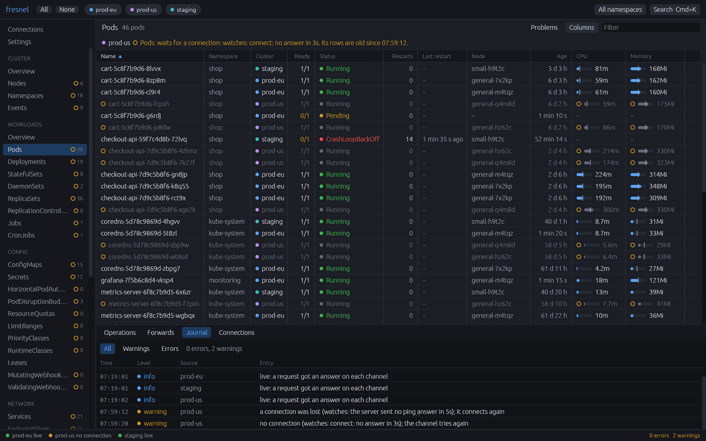
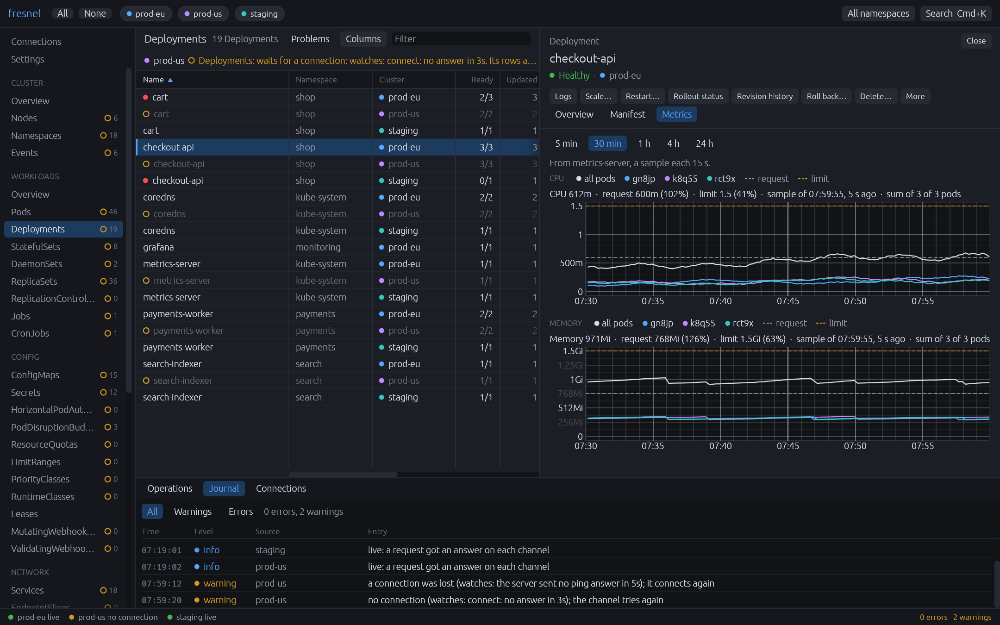
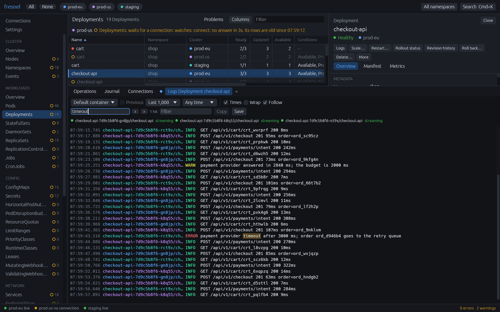
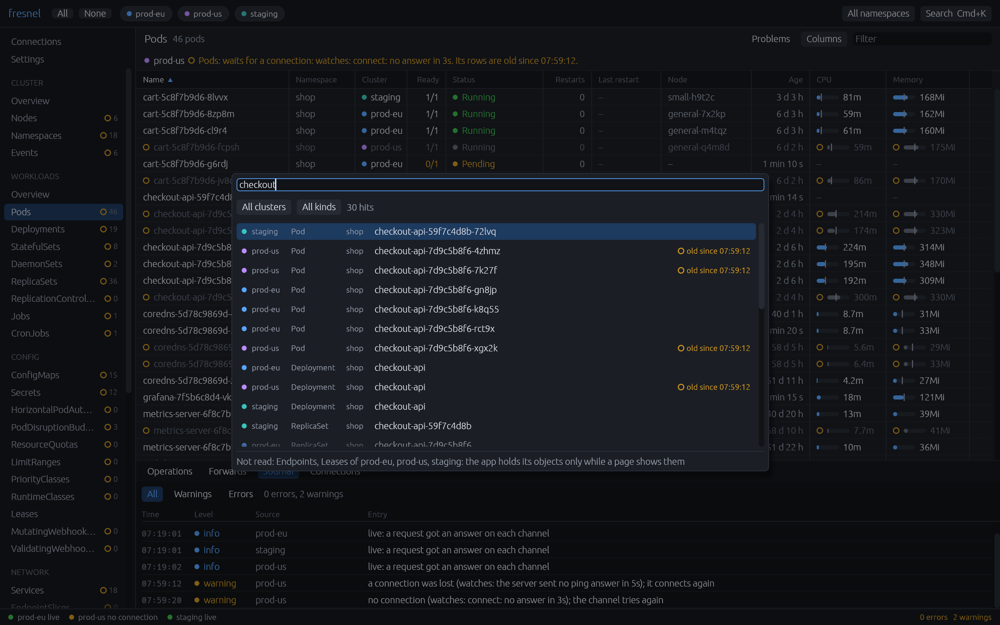
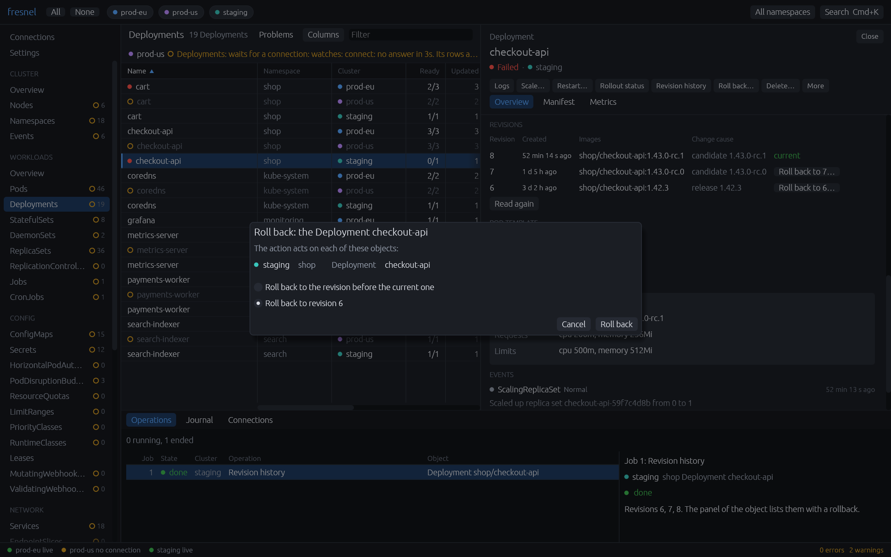
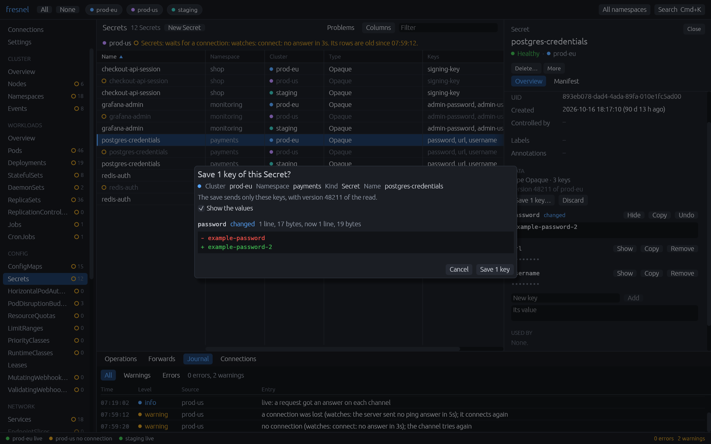
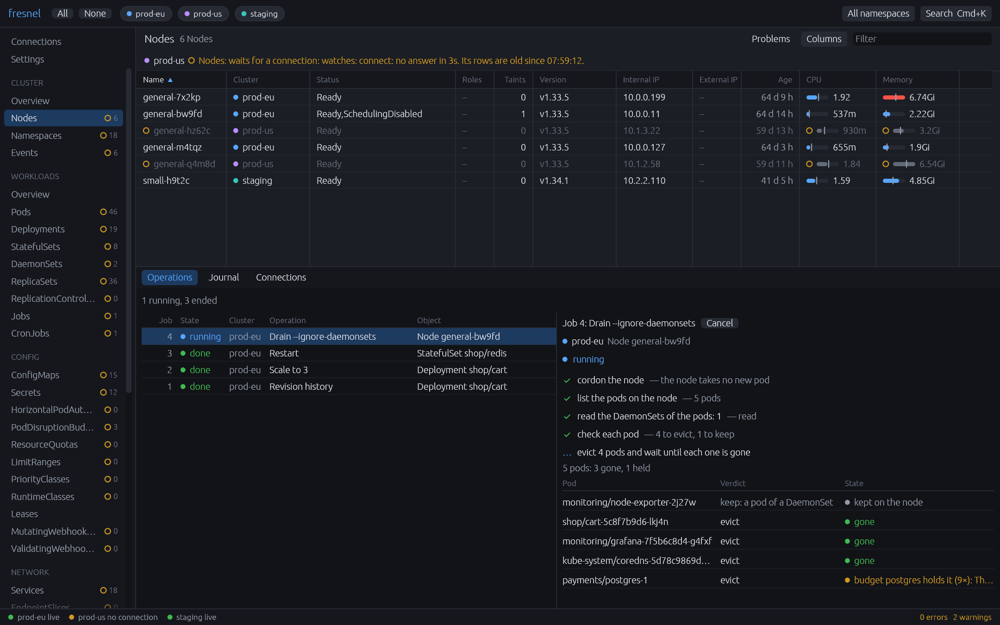
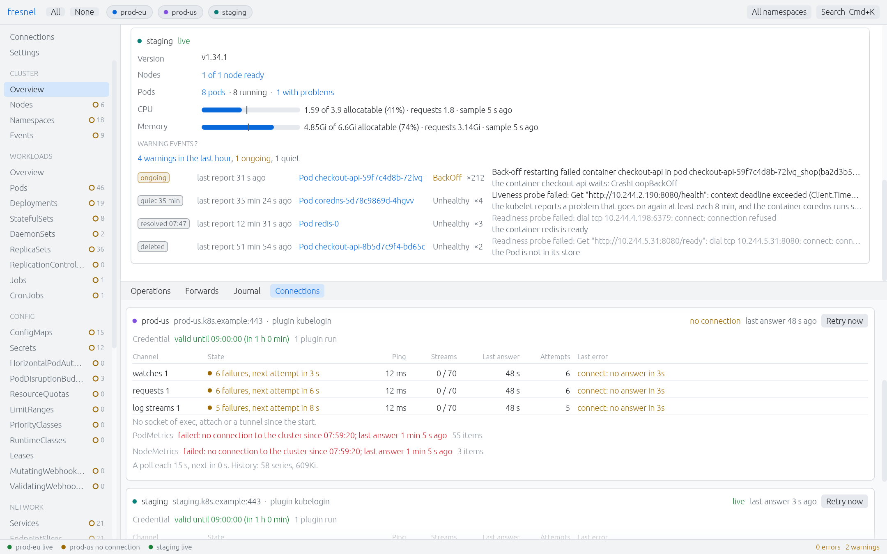

# fresnel

fresnel is a native Kubernetes desktop client in Rust with egui. It shows many clusters in one
window. Its first aim is stability: no stalled connection, no hidden error, and no old data
that looks current.

## Screenshots

<table>
<tr><td width="50%"><a href="docs/screenshots/pods-three-clusters.png"></a><br>The pods of three clusters. prod-us has no connection: its rows are old, and a note tells why.</td>
<td width="50%"><a href="docs/screenshots/deployment-metrics.png"></a><br>The CPU and memory of a Deployment and of each of its pods, with the request and the limit.</td></tr>
<tr><td width="50%"><a href="docs/screenshots/deployment-logs.png"></a><br>The logs of the pods of a Deployment, each pod in its color, with a search.</td>
<td width="50%"><a href="docs/screenshots/quick-search.png"></a><br>Cmd+K: the quick search finds objects of each kind in each cluster.</td></tr>
<tr><td width="50%"><a href="docs/screenshots/rollback.png"></a><br>The revisions of a Deployment and the dialog of a rollback.</td>
<td width="50%"><a href="docs/screenshots/secret-save.png"></a><br>The keys of a Secret: a save sends only the changed key, after its diff.</td></tr>
<tr><td width="50%"><a href="docs/screenshots/node-drain.png"></a><br>A node drain as a job of the Operations tab, with the state of each pod.</td>
<td width="50%"><a href="docs/screenshots/cluster-overview-light.png"></a><br>The cluster overview in the light theme: nodes, pods, usage and warnings.</td></tr>
</table>

## Status

Milestones M0 to M4, M6, M7 and M9 are complete; the work is in M8 (settings, keys, notices, soak).
`fresnel-core` has the kubeconfig, gateway, journal, settings, 41 kinds, stores, indexes, quick
search, commands, operations as jobs, downloads, metrics, logs and notices. The window has a live
table and a panel for each kind, actions, keys, the Operations tab, metrics, logs and settings.

## The app

```sh
cargo xtask install                   # builds Fresnel.app and puts it into /Applications
cargo xtask install --to <folder>     # the same into some other folder
```

The earlier bundle stays as `Fresnel.app.prev`. At its first start, the app selects the current
context of the kubeconfig files. It keeps the selection and the table layouts in `state.json`.

- A table shows each selected cluster. A row with an open ring is from a cluster that is
  not live: its values are old, and a note above the table gives the reason.
- Cmd+K opens the quick search, ? lists each key, Cmd+1 to Cmd+4 and F6 move the focus between
  the sidebar, the table, the panel and the dock. Cmd+[ and Cmd+] go back and forward. A right
  click lists the actions of a row; a change asks, and a read-only cluster refuses it.
- Settings folder: `~/Library/Application Support/fresnel`. A debug build uses `fresnel-debug`.
  Cmd+, opens the settings view, which edits `config.toml` and keeps its comments. The app reads
  it again after each change; the journal tells each problem with its line and column.
- A failed operation, and a cluster that stays lost while the window is hidden, give a notification.
- Log folder: `~/Library/Logs/fresnel` (`fresnel.log`, panic reports). Saved logs and manifests:
  `~/Downloads`. Only one process runs; `cargo run --package fresnel` starts a debug build too.

## Build and test

Install [rustup](https://rustup.rs). The file `rust-toolchain.toml` selects the compiler. On
Linux, the UI tests need the package `mesa-vulkan-drivers`.

```sh
cargo test --workspace                # unit tests and UI tests, with no cluster
FRESNEL_SNAPSHOT_DIR=<folder> cargo test --package fresnel-ui   # also PNG files of the views
cargo test --workspace -- --ignored   # cluster tests, with k3s in Docker
cargo test --release --package fresnel-ui --test views -- frame_time search::time
cargo xtask check-sizes               # size limits of documents and source files
cargo xtask check-borders             # no kube in fresnel-net, no egui in fresnel-core
cargo xtask soak --hours 1            # the core on k3s in Docker with changes and faults
cargo xtask screenshots               # the pictures above, from made-up data with no cluster
```

## The commands of fresnel-cli

Each command runs the code of the app and changes nothing in a cluster. With no context,
`doctor` and `watch` list the contexts and connect to nothing.

```sh
cargo run --package fresnel-cli -- doctor --context <name>   # one cluster; --all: each one
cargo run --package fresnel-cli -- watch --context <name>    # the stores of one cluster
```

- `doctor` sends `GET /version` only and writes `fresnel-doctor.json`: the times of the login
  shell, the plugin and the connects, the stream limit and, with `--idle-close`, the idle close.
- `watch` reads the objects of each kind, as the app does: of a Secret, only the metadata.
  Each 5 seconds, it prints the state and the object count of each store.
- `soak` runs the app core on one cluster and compares each store with the API: a store that shows
  "live" and is behind for more than 20 s, a store or a log view that does not recover, or a heap
  that grows fails it. `cargo xtask soak` adds k3s, faults and a report into `target/release/soak/`.

## Layout

`crates/` has `fresnel-net` (connections, credential plugin, task start), `fresnel-core` (the
domain), `fresnel-ui` (the views), the programs `fresnel` and `fresnel-cli`, and `fresnel-testkit`
(fault proxy, k3s in Docker, fake API server, soak harness). `xtask` has the repository tasks.

## Documents

- [docs/architecture.md](docs/architecture.md): the design rules, the crates and their borders.
- [docs/decisions.md](docs/decisions.md): each decision with its reason.
- [CONTRIBUTING.md](CONTRIBUTING.md): the rules for a change.
